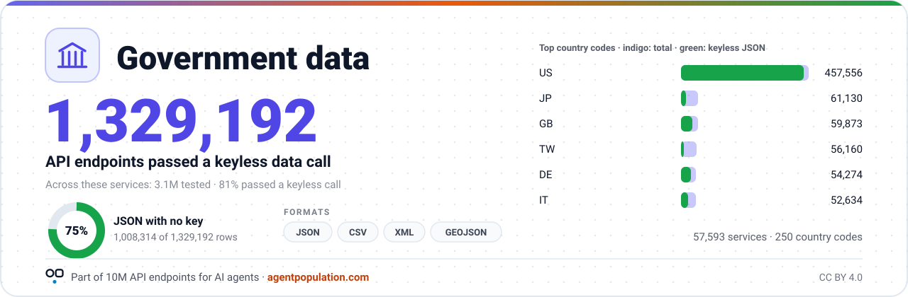
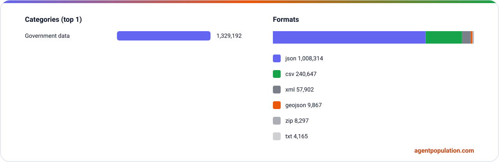

<p align="center"></p>

# 🏛️ Government open data API endpoints

**1,329,192 open-data API endpoints that answered a keyless GET with a data body. For agent and app builders.**

<p align="center"><a href="#files"></a> <a href="#columns-and-tags"></a> <a href="#whats-inside"></a> <a href="#whats-inside"></a> <a href="LICENSE"></a></p>

<p align="center"><a href="#whats-in-it-for-you">What's in it</a> · <a href="#for-ai-agents">For AI agents</a> · <a href="#quick-start">Quick start</a> · <a href="#test-it-yourself">Test it yourself</a> · <a href="#files">Files</a> · <a href="#licence-and-credit">Licence</a> · <a href="#part-of-10m-api-endpoints-for-ai-agents">More packs</a></p>

This repository holds a 1,000-row sample and the services list; the full list of 1,329,192 endpoints is one download from the [latest release](https://github.com/agentpopulation/1.3m-government-open-data-apis/releases/latest).

**Endpoints for building a civic or city agent or app on open-data portals.** Dataset records from city, regional and national open-data portals (Socrata, Opendatasoft, CKAN, data.gouv.fr), municipal CSV and JSON files, and map layers of schools, parks, zoning and public services, as URLs that answered with no key on their test date.

Selection rule: rows where `category is "Government & Open Data"`, less the rows that a leave-out rule drops (each counted under Known limits).

912,282 of these 1,329,192 rows match the focus rule (below); the others are in the pack by the selection rule only, and Known limits says what they are. 459,518 rows (34.6%) are map layers on ArcGIS Online, where anyone can publish.

## In plain words

**What is an API endpoint?** An API endpoint is one web address that a program can ask for data, for example the latest reading at one weather station. A single service, such as a national weather agency, can have thousands of endpoints: one per station, city or dataset. This pack counts endpoints, not separate services.

**What does "passed a data call" mean?** On the date shown in each row, AgentPopulation sent one plain request to that address, with no password or key, and got a non-empty data body back (JSON, CSV, XML or a file): not an error page and not an empty result. Some bodies describe a dataset rather than hold its values; see Known limits. It shows the address answered with data on that day. It is not a promise that it answers today, and licences and usage limits were not reviewed.

## What's in it for you

Four ways to use this pack. Each bucket gives a count, a filter you can apply to the CSV, one example that passed, and a list of recommended starting points with the rule that picked them. Buckets overlap; a row can fit more than one.

Examples, recommended lists and the preview are drawn from rows that match this pack's focus rule, so a row that the selection rule put in this pack but that is about something else is not shown as a starting point. Counts cover the whole bucket.

<details>
<summary>The focus rule</summary>

Focus rule: `NOT (title matches /^HDX: /i OR host in (pndb.opendatasoft.com, datasource.kapsarc.org)) AND (NOT url matches ///(services[0-9]*(-[a-z0-9]+)?|utility)\.arcgis\.com//i OR title matches /\b(city|town|county|municipal|borough|village|township|council|ward|district|parish|state|department|public|school|park|zoning|parcel|librar|fire|police|sidewalk|trail|bridge|evacuation|permit|street|road|hydrant|polling|precinct|boundar)/i)`

</details>

### 🤖 Agent tools: City and national portal records an agent can query (Socrata, Opendatasoft, CKAN)

**120,356** endpoints from 1,200 services · Wrap one portal as a get_city_records tool: pass the dataset id and a filter ($where on Socrata, where on Opendatasoft, q on CKAN), return the matching records with a timeout.

111,574 of these ask for one record (`limit=1` or `$limit=1`); raise the limit or add a filter for more.

Start with: `tags has agent-ready AND subcategory matches /^((socrata|opendatasoft|ckan) dataset|OpenDataSoft network)$/i`

Example: [Estadistica UNDMO](https://datos.gov.co/resource/226x-qjxq.json?$limit=1) · Datos Abiertos Colombia · passed 2026-11-12

<details>
<summary>Recommended starting points: 8 services, picked by the stated criteria inside</summary>

**Recommended starting points.** Selected by stated criteria, not a ranking of quality: Services in this pack with the most endpoints that match this bucket and are tagged `agent-ready` (no key sent in the test call, JSON body, passed a data call). Ties go to the service with more country codes, then by name. Only services with at least one bucket row that matches the focus rule are listed, and the sample comes from those rows; the counts cover the whole bucket. The sample URL is the first row by URL sort after preferring, in this order: rows that match the bucket's sample preference when it has one, rows that return values rather than describe a dataset or a service (not ERDDAP /info/ pages, OGC GetCapabilities requests, bare OWS addresses, PxWeb tables, UN SDG series lists, Statistics Canada download pointers, WorldPop listings, GTFS validation reports, untitled rows or service root addresses), and agent-ready rows. Sample preference in this bucket: `title matches /\S\s+\S/i`. Services named "ArcGIS organization" hold map layers from many owners and are added only when fewer than 5 other services match.

| Service (host) | Endpoints in bucket | In pack | Country codes in bucket | Formats in bucket | Sample URL that passed |
|---|---:|---:|---|---|---|
| Datos Abiertos Colombia (datos.gov.co) | 8,092 | 8,092 | CO | json | [Estadistica UNDMO](https://datos.gov.co/resource/226x-qjxq.json?$limit=1) (2026-11-12) |
| Banque de France Webstat (webstat.banque-france.fr) | 3,975 | 3,975 | FR | json | [Amortissements des immeubles de placeme…](https://webstat.banque-france.fr/api/explore/v2.1/catalog/datasets/acpr-a-bq-activite-tb_fin_comp_coeff_expl7406-456-_z-_z-phnc-_z-top6_aut_groupes/records?limit=1) (2026-11-13) |
| NYC Open Data (Socrata) (data.cityofnewyork.us) | 1,682 | 3,868 | US | json | [DSNY Special Waste Drop-off Sites](https://data.cityofnewyork.us/resource/242c-ru4i.json?$limit=1) (2026-11-11) |
| Rotterdam (data.rotterdam.nl) | 1,432 | 1,432 | NL | json | [Aandeel algemeen](https://data.rotterdam.nl/api/explore/v2.1/catalog/datasets/aandeel_algemeen/records?limit=1) (2026-11-12) |
| Digital Wallonia (digitalwallonia.opendatasoft.com) | 1,152 | 1,152 | BE | json | [029-ores-electricite-et-gaz-taux-de-com…](https://digitalwallonia.opendatasoft.com/api/explore/v2.1/catalog/datasets/029-ores-electricite-et-gaz-taux-de-communicabilite-des-compteurs-smart/records?limit=1) (2026-11-12) |
| Bayareametro (data.bayareametro.gov) | 1,037 | 1,056 | US | json | [(Block Group) Number of Renter Building…](https://data.bayareametro.gov/resource/234v-3byw.json?$limit=1) (2026-11-11) |
| data.wa.gov | 1,013 | 2,161 | US | json | [Report Card Teacher Qualification by Sc…](https://data.wa.gov/resource/229f-7afc.json?$limit=1) (2026-11-12) |
| Iledefrance (opendata.iledefrance.fr) | 1,006 | 1,006 | FR | json | [100-sites-sportifs-emblematiques](https://opendata.iledefrance.fr/api/explore/v2.1/catalog/datasets/100-sites-sportifs-emblematiques/records?limit=1) (2026-11-12) |

</details>

### 📱 App features: Schools, parks, libraries, zoning and public-safety layers for city maps

**27,403** endpoints from 6,928 services · Show the schools, parks, libraries or fire and police stations near an address on a map card; each layer query returns features with names and attributes.

Start with: `subcategory matches /^ArcGIS feature layer · (schools|parks|libraries|fire stations|police stations|zoning|trails|sidewalks|evacuation)$/i`

Example: [Cabarrus County Zoning](https://location.cabarruscounty.us/arcgisservices/rest/services/OpenData/Cabarrus_County_Zoning/MapServer/0/query?where=1%3D1&outFields=*&returnGeometry=false&resultRecordCount=5&f=json) · Cabarruscounty · passed 2026-11-14

<details>
<summary>Recommended starting points: 8 services, picked by the stated criteria inside</summary>

**Recommended starting points.** Selected by stated criteria, not a ranking of quality: Services in this pack with the most endpoints that match this bucket and passed a data call. Ties go to the service with more country codes, then by name. Only services with at least one bucket row that matches the focus rule are listed, and the sample comes from those rows; the counts cover the whole bucket. The sample URL is the first row by URL sort after preferring, in this order: rows that match the bucket's sample preference when it has one, rows that return values rather than describe a dataset or a service (not ERDDAP /info/ pages, OGC GetCapabilities requests, bare OWS addresses, PxWeb tables, UN SDG series lists, Statistics Canada download pointers, WorldPop listings, GTFS validation reports, untitled rows or service root addresses), and agent-ready rows. Sample preference in this bucket: `NOT url matches ///(services[0-9]*(-[a-z0-9]+)?|utility)\.arcgis\.com//i`. Services named "ArcGIS organization" hold map layers from many owners and are added only when fewer than 5 other services match.

| Service (host) | Endpoints in bucket | In pack | Country codes in bucket | Formats in bucket | Sample URL that passed |
|---|---:|---:|---|---|---|
| University of Calgary (ArcGIS Online) (services2.arcgis.com) | 344 | 459 | 7 codes | json | [15 min walking distance to library](https://services2.arcgis.com/XSv3KNGfmrd1txPN/arcgis/rest/services/15%20min%20walking%20distance%20to%20library/FeatureServer/0/query?where=1%3D1&outFields=*&returnGeometry=false&resultRecordCount=5&f=json) (2026-11-14) |
| Clemson University (ArcGIS Online) (services1.arcgis.com) | 217 | 1,588 | 4 codes | json | [All Labels No Cooper Library](https://services1.arcgis.com/x5wCko8UnSi4h0CB/arcgis/rest/services/AllLabels_NoCooperLibrary_WFL1/FeatureServer/0/query?where=1%3D1&outFields=*&returnGeometry=false&resultRecordCount=5&f=json) (2026-11-14) |
| University of Nevada, Reno (ArcGIS Online) (services3.arcgis.com) | 170 | 528 | FR, US | json | [2024 Trails\_4](https://services3.arcgis.com/QCH1Le0vwRIyplqB/arcgis/rest/services/2024trails_start_end/FeatureServer/0/query?where=1%3D1&outFields=*&returnGeometry=false&resultRecordCount=5&f=json) (2026-11-14) |
| University of Minnesota (ArcGIS Online) (services.arcgis.com) | 119 | 1,539 | ES, US | json | [1950 Zoning](https://services.arcgis.com/8df8p0NlLFEShl0r/arcgis/rest/services/1950_Zoning/FeatureServer/0/query?where=1%3D1&outFields=*&returnGeometry=false&resultRecordCount=5&f=json) (2026-11-14) |
| University of Utah Reasearch/Education (ArcGIS Online) (services1.arcgis.com) | 109 | 202 | CA, US | json | [Animal Locations On Trails](https://services1.arcgis.com/2exN3kG1f2h7coIQ/arcgis/rest/services/Animal%20Locations%20On%20Trails/FeatureServer/0/query?where=1%3D1&outFields=*&returnGeometry=false&resultRecordCount=5&f=json) (2026-11-14) |
| GIS Online at UCLA (ArcGIS Online) (services7.arcgis.com) | 101 | 982 | US | json | [Formal County Parks](https://services7.arcgis.com/2hYXmwteFLemN5bW/arcgis/rest/services/2017_Formal_County_Parks/FeatureServer/0/query?where=1%3D1&outFields=*&returnGeometry=false&resultRecordCount=5&f=json) (2026-11-14) |
| University of Arizona GIS (ArcGIS Online) (services1.arcgis.com) | 96 | 819 | GB, TR, US | json | [A3 DR Parks](https://services1.arcgis.com/Ezk9fcjSUkeadg6u/arcgis/rest/services/A3_DR_Parks/FeatureServer/0/query?where=1%3D1&outFields=*&returnGeometry=false&resultRecordCount=5&f=json) (2026-11-14) |
| University of Maryland (ArcGIS Online) (services1.arcgis.com) | 92 | 428 | US | json | [Camp Springs Schools](https://services1.arcgis.com/qTQ6qYkHpxlu0G82/arcgis/rest/services/Camp_Springs_Schools/FeatureServer/0/query?where=1%3D1&outFields=*&returnGeometry=false&resultRecordCount=5&f=json) (2026-11-14) |

</details>

### 🧠 Grounding and data pipelines: Municipal, regional and national files (CSV, XML, ZIP) for scheduled loads

**311,011** endpoints from 3,600 services · Load municipal and national files on a schedule into your own store, keeping the portal and dataset id, so answers about a city cite a dated public record.

Start with: `format in (csv, xml, zip, txt)`

Example: [Дані обліку громадян, які потребують поліпшення ж…](https://data.gov.ua/dataset/000e2494-3d5a-4187-b17b-06cc3ed398c3/resource/b34fe93f-6808-486c-b7be-ba4eeb7f3bf1/download/line.csv) · Портал відкритих даних · passed 2026-11-15

<details>
<summary>Recommended starting points: 8 services, picked by the stated criteria inside</summary>

**Recommended starting points.** Selected by stated criteria, not a ranking of quality: Services in this pack with the most endpoints that match this bucket and passed a data call. Ties go to the service with more country codes, then by name. Only services with at least one bucket row that matches the focus rule are listed, and the sample comes from those rows; the counts cover the whole bucket. The sample URL is the first row by URL sort after preferring, in this order: rows that match the bucket's sample preference when it has one, rows that return values rather than describe a dataset or a service (not ERDDAP /info/ pages, OGC GetCapabilities requests, bare OWS addresses, PxWeb tables, UN SDG series lists, Statistics Canada download pointers, WorldPop listings, GTFS validation reports, untitled rows or service root addresses), and agent-ready rows. Sample preference in this bucket: `format is csv AND title matches /\S\s+\S/i AND NOT url matches /\.(xls|xlsx|gz)$/i`. Services named "ArcGIS organization" hold map layers from many owners and are added only when fewer than 5 other services match.

| Service (host) | Endpoints in bucket | In pack | Country codes in bucket | Formats in bucket | Sample URL that passed |
|---|---:|---:|---|---|---|
| Портал відкритих даних (data.gov.ua) | 15,635 | 18,171 | UA | csv, xml, txt, zip | [Дані обліку громадян, які потребують по…](https://data.gov.ua/dataset/000e2494-3d5a-4187-b17b-06cc3ed398c3/resource/b34fe93f-6808-486c-b7be-ba4eeb7f3bf1/download/line.csv) (2026-11-15) |
| Tycg (opendata.tycg.gov.tw) | 7,757 | 7,760 | TW | csv, xml | [桃園市政府工務局: data.gov.tw dataset resource …](https://opendata.tycg.gov.tw/api/dataset/00127afa-b020-43f9-9ae0-256ca1254c80/resource/1a717396-e378-4ea5-8921-e64271faa60c/download) (2026-11-15) |
| opendata.schleswig-holstein.de | 7,685 | 12,400 | DE | csv, txt, xml | [TransformingAntiquity - Metadaten (Zuor…](https://opendata.schleswig-holstein.de/data/antikensammlung/Metadaten%20%28Zuordnung%29.csv) (2026-11-15) |
| data.taipei | 6,145 | 6,219 | TW | csv, xml, zip | [臺北市政府工務局水利工程處: data.gov.tw dataset reso…](https://data.taipei/api/dataset/0016a730-aef1-43c5-baaf-0f08e270c0f6/resource/98fce0a1-66f9-4b10-b384-1e80a7999e27/download) (2026-11-15) |
| Fews (fdw.fews.net) | 4,774 | 4,821 | global or unknown | xml | [Afghanistan: Acute Food Insecurity Clas…](https://fdw.fews.net/api/ipcphasemap/country/AF/CS/2011-01-01.kml) (2026-11-15) |
| Moi (opdadm.moi.gov.tw) | 4,766 | 4,771 | TW | csv, zip, xml | [戶政司: data.gov.tw dataset resource (CSV)](https://opdadm.moi.gov.tw/api/v1/no-auth/resource/api/dataset/0073DC43-6EDE-4A94-8A0B-56F3521CFCAB/resource/054E4275-C3B6-4E7E-9B45-AC5598BB9E8F/download) (2026-11-15) |
| Plataforma de Datos Abiertos de la Prefe (datosabiertos.carchi.gob.ec) | 4,709 | 4,709 | EC | csv, zip, txt | [29.2 Informacion Publica Empresas Publi…](https://datosabiertos.carchi.gob.ec/dataset/0057f381-fdbc-4747-8a64-51bcf439e921/resource/7363b3a1-0414-4491-b8cd-e3ccc4da099c/download/2025-Abril-Art.-29-Informacion-Publica-Empresas-Publicas-292conjuntodedatos.csv.csv) (2026-11-15) |
| Proyecto Enlaza - Open Data de la provin (enlaza.eprinsa.es) | 4,181 | 5,715 | ES | xml, csv | [Adjudicatarios de obras](https://enlaza.eprinsa.es/file/datahub/0051aeda-69e8-40c2-9e83-3385aa73e57a.csv) (2026-11-15) |

</details>

### 🧪 Evals and testing: Portal records, layers and files to test a civic-data tool

**1,329,192** endpoints · 57,593 services · 250 country codes · 6 formats · Run your civic-data tool against a fixed set of URLs across portals and formats; check that records, fields and dates parse, and keep last_tested as the baseline for your own re-tests.

Start with: the whole pack

Example: [Звіти про використання бюджетних коштів КСП "Інже…](https://data.gov.ua/dataset/018609e2-ffe8-44ff-bf36-132fa802895e/resource/20013b47-3c04-4960-9c9d-812c28bdc5ea/download/37577078_35_4382904.json) · Портал відкритих даних · passed 2026-11-15

<details>
<summary>Recommended starting points: 8 services, picked by the stated criteria inside</summary>

**Recommended starting points.** Selected by stated criteria, not a ranking of quality: Services in this pack that returned the most different formats, then the most endpoints that passed a data call, then by name: a mix of response shapes to test parsers and tool calls. Only services with at least one bucket row that matches the focus rule are listed, and the sample comes from those rows; the counts cover the whole bucket. The sample URL is the first row by URL sort after preferring, in this order: rows that match the bucket's sample preference when it has one, rows that return values rather than describe a dataset or a service (not ERDDAP /info/ pages, OGC GetCapabilities requests, bare OWS addresses, PxWeb tables, UN SDG series lists, Statistics Canada download pointers, WorldPop listings, GTFS validation reports, untitled rows or service root addresses), and agent-ready rows. Sample preference in this bucket: `title matches /\S\s+\S/i`. Services named "ArcGIS organization" hold map layers from many owners and are added only when fewer than 5 other services match.

| Service (host) | Endpoints in bucket | In pack | Country codes in bucket | Formats in bucket | Sample URL that passed |
|---|---:|---:|---|---|---|
| Портал відкритих даних (data.gov.ua) | 18,171 | 18,171 | UA | csv, json, xml, txt, zip, geojson | [Звіти про використання бюджетних коштів…](https://data.gov.ua/dataset/018609e2-ffe8-44ff-bf36-132fa802895e/resource/20013b47-3c04-4960-9c9d-812c28bdc5ea/download/37577078_35_4382904.json) (2026-11-15) |
| Tokyo Open Data CKAN portal (www.opendata.metro.tokyo.lg.jp) | 3,476 | 3,476 | JP | csv, geojson, txt, json, zip, xml | [H21緑被分布 - H21緑被分布情報(geojson形式)](https://www.opendata.metro.tokyo.lg.jp/shinagawa/h21ryokuhibunpu.geojson) (2026-11-15) |
| Greece National Data Portal (data.gov.gr) | 2,345 | 2,345 | GR | json, csv, xml, geojson, txt, zip | [Απασχόληση και Αγορά Εργασίας Δήμου Πατ…](https://data.gov.gr/api/3/action/datastore_search?resource_id=004f8882-bd32-4e80-a0a6-9fc91a76e396&limit=1) (2026-11-15) |
| datamillnorth.org | 1,301 | 1,301 | GB | csv, xml, geojson, json, txt, zip | [Community services - April 2020](https://datamillnorth.org/download/29r6j/4c170c50-09d0-4f14-8725-3477f0310d5c/Community%20with%20postcodes%20Apr_2020-with-coordinates.geojson) (2026-11-15) |
| Datos Abiertos Bogotá (datosabiertos.bogota.gov.co) | 787 | 787 | CO | json, csv, geojson, xml, txt, zip | [Ejecución Presupuestal](https://datosabiertos.bogota.gov.co/api/3/action/datastore_search?resource_id=01f8241b-3cf5-4166-98ea-a60ddc36d402&limit=1) (2026-11-12) |
| Public (download.data.public.lu) | 314 | 314 | LU | json, zip, xml, geojson, csv, txt | [SIG-GR @ Ministère du Logement et de l'…](https://download.data.public.lu/resources/administrative-entities-2018/20200325-152406/administrative-entities-2018-1808-vg-vfg-vfs-gks-rlp-2018-3.geojson) (2026-11-15) |
| Dublinked Open Data for the Dublin Regio (data.smartdublin.ie) | 123 | 123 | IE | csv, json, geojson, xml, zip, txt | [Burial Grounds DLR](https://data.smartdublin.ie/dataset/02e4b256-e517-4bf3-b719-4f53bed64765/resource/8fa299dd-faae-4468-b578-f52eb0c03033/download/burialgrounds_dlr.geojson) (2026-11-13) |
| data.taipei | 6,219 | 6,219 | TW | csv, xml, json, geojson, zip | [臺北市政府工務局新建工程處: data.gov.tw dataset reso…](https://data.taipei/api/dataset/03e017d7-674d-4665-b874-5a6a020668e4/resource/7ce99e98-be5e-4332-a2b6-4f0980de82e3/download) (2026-11-15) |

</details>

The same lists are in [recommended.json](recommended.json), ready for an agent to load.

## Questions an agent can answer with this pack

- Which public contracts have Colombian agencies signed in SECOP II? Try [SECOP II - Contratos Electrónicos](https://datos.gov.co/resource/jbjy-vk9h.json?$limit=1) (Datos Abiertos Colombia, passed 2026-11-11).
- What building permits has the City of Chicago issued? Try [Building Permits](https://data.cityofchicago.org/resource/ydr8-5enu.json?$limit=1) (City of Chicago Data Portal, passed 2026-11-11).
- What do the demographic figures of an Italian municipality show? Try [Municipal open data - Andezeno (001009)](https://cruscotto-italia.dati.gov.it/data/demografia/001009.json) (Italia Dati municipal dashboards, passed 2026-11-14).

## What "passed a data call" means

> [!NOTE]
> On the date in `last_tested` (IST), one GET to the URL, sent with no key, returned HTTP 2xx and a non-empty data body. HTML pages and empty results did not pass. The `format` column records what came back. This is a test result for that date, not a promise that the URL answers today. Licences, terms, rate limits, accuracy and freshness were not reviewed. Endpoints are URLs, not separate APIs; many share one service. This pack was tested 10–15 Nov 2026; snapshot 15 Nov 2026.

## For AI agents

Start from keyless JSON endpoints (`agent-ready`). The code below loads `recommended.json` and calls the first recommended service in the Agent tools bucket, with a timeout (`node examples/agent-start.mjs --recommended`). With no argument, `node examples/agent-start.mjs` calls the most recently tested agent-ready row of the sample; pass a `.csv` or `.csv.gz` path to use that file instead. See [examples/agent-start.mjs](examples/agent-start.mjs).

```js
// Node 18+. Loads recommended.json (the local copy, or the raw file on GitHub) and calls one keyless JSON endpoint.
import fs from 'node:fs';

const RAW = 'https://raw.githubusercontent.com/agentpopulation/1.3m-government-open-data-apis/main/recommended.json';
const rec = fs.existsSync('recommended.json')
  ? JSON.parse(fs.readFileSync('recommended.json', 'utf8'))
  : await (await fetch(RAW)).json();

const pick = rec.buckets.find((b) => b.id === 'agent').services[0];
try {
  const res = await fetch(pick.sample_url, {
    headers: { 'User-Agent': 'agent-example/1.0' },
    signal: AbortSignal.timeout(15000),
  });
  console.log(pick.service, res.status, res.headers.get('content-type'));
  console.log((await res.text()).slice(0, 300));
} catch (err) {
  console.log(`did not answer now; last passed ${pick.sample_last_tested} (${err.message})`);
}
```

How an agent picks an endpoint:

1. Filter to `agent-ready` and your country or topic.
2. Prefer the newest `last_tested` and the larger services.
3. Call with a timeout and check the body before you use it.

## Quick start

The examples run against the sample in `data/` out of the box (1,000 rows). Each takes an optional path to a `.csv` or `.csv.gz` file instead.

```bash
git clone https://github.com/agentpopulation/1.3m-government-open-data-apis.git
cd 1.3m-government-open-data-apis
python examples/quickstart.py
node examples/quickstart.mjs
node examples/agent-start.mjs
```

Full list: download `Government_Open_Data_API_Endpoints_AgentPopulation_Snapshot_2026-11-15.csv.gz` (1,329,192 rows, 52.2 MB) from [releases/latest](https://github.com/agentpopulation/1.3m-government-open-data-apis/releases/latest), then gunzip it and pass its path. The scripts also read the `.csv.gz` as it is.

```bash
gunzip Government_Open_Data_API_Endpoints_AgentPopulation_Snapshot_2026-11-15.csv.gz
python examples/quickstart.py Government_Open_Data_API_Endpoints_AgentPopulation_Snapshot_2026-11-15.csv
node examples/quickstart.mjs Government_Open_Data_API_Endpoints_AgentPopulation_Snapshot_2026-11-15.csv
```

### curl

Quote the URL: some contain commas.

```bash
curl -sL "https://raw.githubusercontent.com/agentpopulation/1.3m-government-open-data-apis/main/data/Government_Open_Data_API_Endpoints_AgentPopulation_Sample.csv" | head -n 4
curl -s --max-time 15 "https://datos.gov.co/resource/226x-qjxq.json?$limit=1" | head -c 600
```

### Python

Standard library only: [examples/quickstart.py](examples/quickstart.py) reads the sample, or the path you pass, keeps agent-ready rows and calls the most recently tested one.

<details>
<summary>The code</summary>

```python
# Python 3, standard library only. Run from a clone of this repository:
#   python examples/quickstart.py [path]
# With no path it reads the sample in data/. Pass the full list from the latest release (.csv or .csv.gz) instead.
# Keeps agent-ready rows and calls the most recently tested one.
import csv
import gzip
import os
import re
import sys
import urllib.request

HERE = os.path.dirname(os.path.abspath(__file__))
path = sys.argv[1] if len(sys.argv) > 1 else os.path.join(HERE, "..", "data", "Government_Open_Data_API_Endpoints_AgentPopulation_Sample.csv")
opener = gzip.open if path.endswith(".gz") else open
with opener(path, "rt", newline="", encoding="utf-8") as f:
    rows = list(csv.DictReader(f))

agent = [r for r in rows if "agent-ready" in r["tags"].split("|")]
# Newest test date first; URLs that describe a dataset or a service rather than return values go last.
DESCRIBES = re.compile(r"/erddap/info/|action-report\.json$|[?&]request=getcapabilities|/GeoArea/[^/?]+/List|getFullTableDownloadCSV|hub\.worldpop\.org", re.I)
agent.sort(key=lambda r: r["last_tested"], reverse=True)
agent.sort(key=lambda r: 1 if DESCRIBES.search(r["url"]) else 0)
print(len(rows), "rows,", len(agent), "agent-ready")
if not agent:
    sys.exit(0)

row = agent[0]
req = urllib.request.Request(row["url"], headers={"User-Agent": "agent-example/1.0"})
try:
    with urllib.request.urlopen(req, timeout=15) as res:
        body = res.read(1_000_000).decode("utf-8", "replace")
        print(res.status, res.headers.get("Content-Type"))
        print(body[:300])
except Exception as err:
    print(f"did not answer now; last passed {row['last_tested']} ({err})")
```

</details>

### JavaScript

Reads the sample as JSON because the CSV has quoted commas.

<details>
<summary>The code</summary>

```js
// Node 18+. Reads the sample as JSON (the CSV has quoted commas), local file first.
import fs from 'node:fs';

const FILE = 'data/Government_Open_Data_API_Endpoints_AgentPopulation_Sample.json';
const rows = fs.existsSync(FILE)
  ? JSON.parse(fs.readFileSync(FILE, 'utf8'))
  : await (await fetch('https://raw.githubusercontent.com/agentpopulation/1.3m-government-open-data-apis/main/data/Government_Open_Data_API_Endpoints_AgentPopulation_Sample.json')).json();

const row = rows.find((r) => r.tags.includes('agent-ready'));
const res = await fetch(row.url, { headers: { 'User-Agent': 'agent-example/1.0' }, signal: AbortSignal.timeout(15000) });
console.log(res.status, (await res.text()).slice(0, 300));
```

</details>

### Agent tools

[examples/agent-tools.json](examples/agent-tools.json) holds two tool definitions in the shape most tool-calling APIs accept (name, description, JSON Schema); rename `parameters` if yours uses another key. [examples/quickstart.mjs](examples/quickstart.mjs) implements them:

- `find_endpoints` searches the agent-ready rows of the list by words, country code (their format is json). When you load the tools of more than one pack, prefix the names (for example `government_open_data_find_endpoints`) so they do not clash.
- `fetch_endpoint` calls one URL, **refuses any URL that is not in the list** and does not follow redirects. The allowlist is built from the CSV, so a URL injected into a prompt is refused.

The same two tools can sit behind an MCP server.

## Test it yourself

Re-test endpoints from the sample with the same rule: HTTP 2xx and a non-empty body that is not an HTML page. Node 18+, no packages.

```bash
node tools/test-endpoints.mjs
```

It tests the first 50 URLs and prints one line: tested, passed, did not pass. Options: a `.csv` or `.csv.gz` path (the full list from the release), `--limit 50`, `--timeout-ms 10000`, `--out results.csv`. The results file holds `url`, `status`, `passed`, `content_type`, `ms` and `checked_at`; a status of `timeout` or `error:<code>` means no HTTP answer came back. It is polite: GET only, no key sent, at most 4 requests in flight, one at a time per listed host, at least 1 second between requests to one listed host, and reading stops once 256 kB of a body is kept. Redirects are followed and may lead to another host. `results.csv` is in `.gitignore`.

## Preview

One row from each of the five largest services among rows that match the focus rule, services with rows that return values first.

| Title | Service | Country | Format | Tested | Link |
|---|---|---|---|---|---|
| Звіти про використання бюджетних коштів КСП "Інженерні мере… | Портал відкритих даних | UA | json | 2026-11-15 | [data.gov.ua](https://data.gov.ua/dataset/018609e2-ffe8-44ff-bf36-132fa802895e/resource/20013b47-3c04-4960-9c9d-812c28bdc5ea/download/37577078_35_4382904.json) |
| urn-siemac-es-caib-ibestat-infomodel-jaxi-dataset-ibestat-v… | Catálogo de datos abiertos del IBESTAT | ES | json | 2026-11-15 | [intranet.caib.es](https://intranet.caib.es/ibestat-jaxi/tabla.do?typeDownload=6&px=00045648-aa4e-4604-9012-6232cb1f4e94) |
| Gebäude - gemeinden\_gebaeude.json | opendata.schleswig-holstein.de | DE | json | 2026-11-15 | [opendata.schleswig-holstein.de](https://opendata.schleswig-holstein.de/data/nordkirche/gemeinden_gebaeude.json) |
| Municipal open data - Alpignano (001008) | Italia Dati municipal dashboards | IT | json | 2026-11-14 | [cruscotto-italia.dati.gov.it](https://cruscotto-italia.dati.gov.it/data/agcom_bbmap/001008.json) |
| Estadistica UNDMO | Datos Abiertos Colombia | CO | json | 2026-11-12 | [datos.gov.co](https://datos.gov.co/resource/226x-qjxq.json?$limit=1) |

Browse the 1,000-row sample: [Sample CSV](data/Government_Open_Data_API_Endpoints_AgentPopulation_Sample.csv) · [Sample JSON](data/Government_Open_Data_API_Endpoints_AgentPopulation_Sample.json).

## What's inside

<p align="center"></p>

<details>
<summary>Country codes: 250</summary>

| Code | Country | Endpoints | |
|---|---|---:|---|
| US | United States | 457,556 | `████████████████████` |
| JP | Japan | 61,130 | `██▋` |
| GB | United Kingdom | 59,873 | `██▋` |
| TW | Taiwan | 56,160 | `██▌` |
| DE | Germany | 54,274 | `██▍` |
| IT | Italy | 52,634 | `██▎` |
| ES | Spain | 51,956 | `██▎` |
| ID | Indonesia | 41,519 | `█▉` |
| FR | France | 35,648 | `█▌` |
| CO | Colombia | 24,936 | `█▏` |
| | other 240 codes | 335,756 | |
| | global or unknown | 97,750 | `████▎` |

</details>

<details>
<summary>Categories: top 1</summary>

| Category | Endpoints | |
|---|---:|---|
| Government & Open Data | 1,329,192 | `████████████████████` |

</details>

Formats: json 1,008,314 · csv 240,647 · xml 57,902 · geojson 9,867 · zip 8,297 · txt 4,165

<details>
<summary>Largest services: top 25 of 57,593</summary>

| Service | Host | Endpoints | Keyless JSON | |
|---|---|---:|---:|---|
| Портал відкритих даних | data.gov.ua | 18,171 | 2,531 | `████████████████████` |
| Catálogo de datos abiertos del IBESTAT | intranet.caib.es | 16,338 | 16,338 | `██████████████████` |
| opendata.schleswig-holstein.de | opendata.schleswig-holstein.de | 12,400 | 4,715 | `█████████████▋` |
| Italia Dati municipal dashboards | cruscotto-italia.dati.gov.it | 8,453 | 5,377 | `█████████▎` |
| Datos Abiertos Colombia | datos.gov.co | 8,092 | 8,092 | `████████▉` |
| www.datos.gov.co | www.datos.gov.co | 7,797 | 7,797 | `████████▋` |
| Tycg | opendata.tycg.gov.tw | 7,760 | 3 | `████████▌` |
| Datos Abiertos de Panamá | www.datosabiertos.gob.pa | 6,948 | 2,831 | `███████▋` |
| data.taipei | data.taipei | 6,219 | 40 | `██████▉` |
| PNDB Open Data † | pndb.opendatasoft.com | 5,788 | 5,788 | `██████▍` |
| Proyecto Enlaza - Open Data de la provin | enlaza.eprinsa.es | 5,715 | 1,534 | `██████▎` |
| Lombardia | www.dati.lombardia.it | 5,608 | 3,072 | `██████▏` |
| Ireland Open Data Portal | ws.cso.ie | 5,513 | 2,753 | `██████▏` |
| Fews | fdw.fews.net | 4,821 | 36 | `█████▎` |
| Moi | opdadm.moi.gov.tw | 4,771 | 5 | `█████▎` |
| Plataforma de Datos Abiertos de la Prefe | datosabiertos.carchi.gob.ec | 4,709 | 0 | `█████▏` |
| OpenData Milano | dati.comune.milano.it | 4,639 | 3,561 | `█████▏` |
| Kabupaten Serang Open Data | opendata.serangkab.go.id | 4,058 | 0 | `████▌` |
| Banque de France Webstat | webstat.banque-france.fr | 3,975 | 3,975 | `████▍` |
| NYC Open Data (Socrata) | data.cityofnewyork.us | 3,868 | 2,550 | `████▎` |
| opendata.pref.tokushima.lg.jp | opendata.pref.tokushima.lg.jp | 3,658 | 3 | `████` |
| Tokyo Open Data CKAN portal | www.opendata.metro.tokyo.lg.jp | 3,476 | 3 | `███▉` |
| Tokyo Open Data CKAN portal | catalog.data.metro.tokyo.lg.jp | 3,473 | 3,473 | `███▉` |
| tabular-api.data.gouv.fr | tabular-api.data.gouv.fr | 3,441 | 3,441 | `███▊` |
| Open Data Kubu Raya | satudata.kuburayakab.go.id | 3,423 | 2,716 | `███▊` |

† No row of this service matches the focus rule: the selection rule put it in this pack, so it is not used as a starting point.

</details>

<details>
<summary>Rows per test date: 10–15 Nov 2026</summary>

| Date (IST) | Endpoints | |
|---|---:|---|
| 2026-11-15 | 1,074,036 | `████████████████████` |
| 2026-11-14 | 110,570 | `██` |
| 2026-11-13 | 25,418 | `▌` |
| 2026-11-12 | 90,080 | `█▋` |
| 2026-11-11 | 29,087 | `▌` |
| 2026-11-10 | 1 | `▏` |

</details>

## Files

| File | Rows | Size | Use |
|---|---:|---:|---|
| [data/Government_Open_Data_API_Services_AgentPopulation.csv](data/Government_Open_Data_API_Services_AgentPopulation.csv) | 57,593 | 2.9 MB | One row per service with its endpoint count in this pack |
| [data/Government_Open_Data_API_Endpoints_AgentPopulation_Sample.csv](data/Government_Open_Data_API_Endpoints_AgentPopulation_Sample.csv) | 1,000 | 294.7 kB | The sample: focus-rule rows first, each service in proportion to its share; ArcGIS Online layers count as one service |
| [data/Government_Open_Data_API_Endpoints_AgentPopulation_Sample.json](data/Government_Open_Data_API_Endpoints_AgentPopulation_Sample.json) | 1,000 | 489.3 kB | The same rows as JSON, tags as an array |
| [Government_Open_Data_API_Endpoints_AgentPopulation_Snapshot_2026-11-15.csv.gz](https://github.com/agentpopulation/1.3m-government-open-data-apis/releases/latest) | 1,329,192 | 52.2 MB | The full list, gzipped CSV: a download from the latest release, checked by `SHA256SUMS.txt` |
| [tools/test-endpoints.mjs](tools/test-endpoints.mjs) | | | Re-tests endpoints from the sample or the full list |

Sample size: 1,000 rows, which is 1,000 or one third of the pack rounded down, whichever is smaller. Rows that match the focus rule come first. Each service gets rows in proportion to its share of those rows, at least one for the largest services and at most 50% of the sample while other services have rows; ArcGIS Online layers count as one service, whatever their organisation. Within a service, agent-ready rows, rows that return values and the newest test dates come first, and rows are written in turn across services. Service root addresses are placed at the end of the sample.

Full list: download `Government_Open_Data_API_Endpoints_AgentPopulation_Snapshot_2026-11-15.csv.gz` (1,329,192 rows, 52.2 MB) from [releases/latest](https://github.com/agentpopulation/1.3m-government-open-data-apis/releases/latest), then gunzip it and pass its path. The scripts also read the `.csv.gz` as it is.

Excel users: Data > From Text/CSV, UTF-8. Files are UTF-8 without a byte-order mark and comma-separated.

## Columns and tags

<details>
<summary>Columns, types and tags</summary>

| Column | Type | Example | Meaning |
|---|---|---|---|
| url | string | [https://data.gov.ua/dataset/018609e2-ff…](https://data.gov.ua/dataset/018609e2-ffe8-44ff-bf36-132fa802895e/resource/20013b47-3c04-4960-9c9d-812c28bdc5ea/download/37577078_35_4382904.json) | The address that was tested |
| title | string | Звіти про використання бюджетних коштів… | Station, dataset or feed name |
| service | string | Портал відкритих даних | The service the endpoint belongs to; joins to the services file together with host |
| host | string | data.gov.ua | Host name of the address |
| country | string | UA | ISO 3166-1 alpha-2 code, or EU; empty when global or unknown |
| category | string | Government & Open Data | Category of the endpoint |
| subcategory | string |  | Left empty from the 15 Nov 2026 snapshot; kept so the columns stay the same |
| format | string | json | What the test call returned: json, csv, geojson, xml, gtfs, zip, txt and so on |
| tags | string | `government\|open-data\|no-key\|json\|agent-…` | Tags separated by \| |
| last_tested | date | 2026-11-15 | Date of the test call, YYYY-MM-DD (IST) |

| Tag | Rows | Meaning |
|---|---:|---|
| government | 1,329,192 | Topic tag |
| no-key | 1,329,192 | No key was sent in the test call |
| open-data | 1,329,192 | Topic tag |
| agent-ready | 1,008,314 | No key sent, JSON body, passed a data call on last_tested |
| json | 1,008,314 | Format of the body |
| maps | 521,533 | Topic tag |
| csv | 240,647 | Format of the body |
| xml | 57,902 | Format of the body |
| statistics | 21,862 | Topic tag |
| transit | 21,332 | Topic tag |
| geojson | 9,867 | Format of the body |
| finance | 6,341 | Topic tag |
| science | 4,793 | Topic tag |
| weather | 4,189 | Topic tag |
| aviation | 3,647 | Topic tag |
| mcp-server | 3,126 | Topic tag |
| health | 2,193 | Topic tag |
| energy | 2,061 | Topic tag |
| economy | 1,965 | Topic tag |
| environment | 1,847 | Topic tag |
| ai-ml | 1,665 | Topic tag |
| oceans | 1,157 | Topic tag |
| parking | 846 | Topic tag |
| hazards | 819 | Topic tag |
| rivers | 781 | Topic tag |
| forecast | 661 | Topic tag |
| maritime | 587 | Topic tag |
| floods | 424 | Topic tag |
| air-quality | 365 | Topic tag |
| speech | 325 | Topic tag |
| elevation | 290 | Topic tag |
| traffic | 228 | Topic tag |
| climate | 211 | Topic tag |
| earthquakes | 160 | Topic tag |
| groundwater | 89 | Topic tag |
| wildfire | 86 | Topic tag |
| tides | 79 | Topic tag |
| volcanoes | 79 | Topic tag |
| llm | 75 | Topic tag |
| geocoding | 69 | Topic tag |
| tsunami | 36 | Topic tag |
| embeddings | 31 | Topic tag |
| bike-share | 26 | Topic tag |
| image-gen | 4 | Topic tag |
| gtfs | 2 | GTFS feed |
| gbfs | 1 | GBFS feed |

A machine-readable copy of this dictionary is in [datapackage.json](datapackage.json).

</details>

## Known limits

- 34.4% of rows carry country code US; 97,750 rows have no code (global or unknown).
- 1,368 rows come from PxWeb or Statistics Canada services. Some statistics endpoints return metadata or a pointer on GET; the table may need a second request or a POST.
- 505,280 rows are map-layer queries with resultRecordCount set: the tested call asked for a few records; change the query to get the full layer.
- 105,811 rows carry limit=1: the tested call asked for one record; raise the limit or page through.
- 145,326 rows are open-data portal dataset records, which may return a dataset record with links rather than the table itself.
- 12,462 rows are files (zip 8,297, txt 4,165) rather than bodies an agent reads directly.
- 2,394 rows are service root addresses (the host alone or an API or version path such as /v1, with no query), which may describe the service rather than return data; the sample, examples and recommended lists use other rows first.
- 456,571 rows are map layers on ArcGIS Online (services*.arcgis.com and utility.arcgis.com), where anyone can publish: layers from many owners, not only governments. Check the layer owner before you use one; only layers with a civic term in the title are used as starting points.
- 1,109 rows are OpenStreetMap extracts listed on the Humanitarian Data Exchange (titles starting "HDX:"), community map data rather than government records.
- 5,788 rows from pndb.opendatasoft.com are biodiversity research datasets (species counts, sightings, genetics), not civic records.
- 1,240 rows from datasource.kapsarc.org are energy and economics research datasets, not civic records; they are not used as starting points.
- 330,405 rows have a dataset id as their title rather than a name; read the record to see what it holds.
- Stations and feeds can go quiet after their test date; re-test a URL before you rely on it.
- Not in this pack: endpoints that need a key or a POST, and URLs that did not pass.
- Left out: 1,161 rows whose URL carried a credential-looking parameter or a login.
- Left out: 2 rows with a private or local address.
- Left out: 10 rows with an email-like address.
- Left out: 29,696 ArcGIS Survey123 layers (they can hold people's form answers).
- Left out: 11 camera or image URLs (webcam and camera feeds, picture and video files).
- Left out: 49 class-exercise copies of the same few ArcGIS Online layers (Miami Beach sea level rise, high-risk areas without shelter, flooded areas, sea level rise and storm surge maps) across many organisations, many with a person's name in the title.
- Left out: 273 layers marked editable in the title (they can hold entries that people added).
- Left out: 5,340 ArcGIS layers that keep a form's default service name (they can hold people's form answers).
- Left out: 18 rows that passed a data call only from a network location in India.
- Left out: 5,173 ArcGIS class or coursework layers (lab, assignment, exam, quiz, lesson, exercise, tutorial and final-project layers, copies of class layers, layers named for a person or a person's home, and layers whose name ends in a person's name or holds a student number).
- Left out: 947 ArcGIS layers that hold reports, comments, submissions or form responses sent in by the public.
- Left out: 102,904 rows of server information from Mastodon, PeerTube, Lemmy, Nostr and other social network servers (instance documents name the server's contact person).
- Left out: 1 row that repeats an address already in the pack.

## Licence and credit

> [!IMPORTANT]
> This list (URLs, titles, tags and test results) is © 2026 AgentPopulation, released under [CC BY 4.0](https://creativecommons.org/licenses/by/4.0/). Credit AgentPopulation and link agentpopulation.com. The data each endpoint returns belongs to its provider and stays under that provider's terms; this licence does not cover it.

Copy-ready credit:

`Government open data API endpoints by AgentPopulation (https://agentpopulation.com), CC BY 4.0, snapshot 15 Nov 2026.`

GitHub's "Cite this repository" button reads [CITATION.cff](CITATION.cff).

<!-- agentpopulation:start -->
## Part of 10M API endpoints for AI agents

This pack is one of the 24 topic packs of [10m-open-apis-for-ai-agents](https://github.com/agentpopulation/10m-open-apis-for-ai-agents), the open collection by [AgentPopulation](https://agentpopulation.com). Target: 10 million+ open API endpoints that pass a keyless API call.

AgentPopulation has tested over 5 million API endpoints: 5,129,834 tested, 3,726,509 passed a data call (snapshot 15 Nov 2026). This is the open-data pack: 1,329,192 endpoints from 57,593 services. Packs overlap, so an endpoint can appear in more than one.

For the latest tested endpoints, search [agentpopulation.com/apis](https://agentpopulation.com/apis). This pack is a snapshot from 15 Nov 2026.

Sibling packs that share the most URLs with this one: [2.5m-agent-ready-apis](https://github.com/agentpopulation/2.5m-agent-ready-apis) (1,008,314 shared) · [270k-transit-apis-for-agents](https://github.com/agentpopulation/270k-transit-apis-for-agents) (22,366 shared) · [130k-finance-economy-apis-for-agents](https://github.com/agentpopulation/130k-finance-economy-apis-for-agents) (8,283 shared) · [130k-india-apis-for-agents](https://github.com/agentpopulation/130k-india-apis-for-agents) (5,038 shared) · [190k-weather-apis-for-agents](https://github.com/agentpopulation/190k-weather-apis-for-agents) (4,943 shared) · [270k-water-apis-for-agents](https://github.com/agentpopulation/270k-water-apis-for-agents) (2,525 shared). The rest are listed in [10m-open-apis-for-ai-agents](https://github.com/agentpopulation/10m-open-apis-for-ai-agents).

Questions, pack requests, reports of endpoints that stopped answering and requests to remove a row go to [Discussions](https://github.com/agentpopulation/10m-open-apis-for-ai-agents/discussions), or to [@agentpopulation](https://x.com/agentpopulation) on X. The packs are a work in progress and corrections are welcome.

Spotted a wrong row or a dead URL? Tell us on X: [@agentpopulation](https://x.com/agentpopulation).

If this pack saved you time, a star helps others find it.

---

Compiled by [AgentPopulation](https://agentpopulation.com) with [AP Desk](https://github.com/agentpopulation/apdesk) · [10m-open-apis-for-ai-agents](https://github.com/agentpopulation/10m-open-apis-for-ai-agents)

<!-- agentpopulation:end -->
